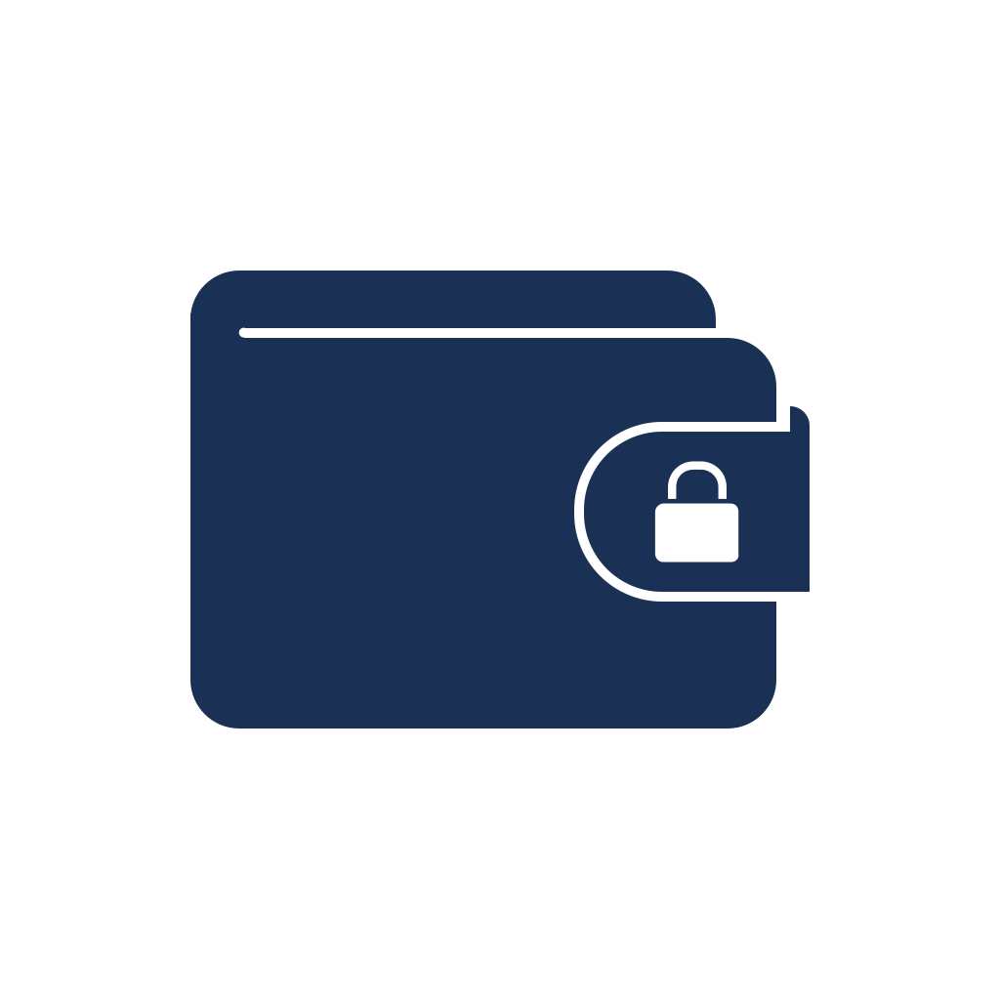
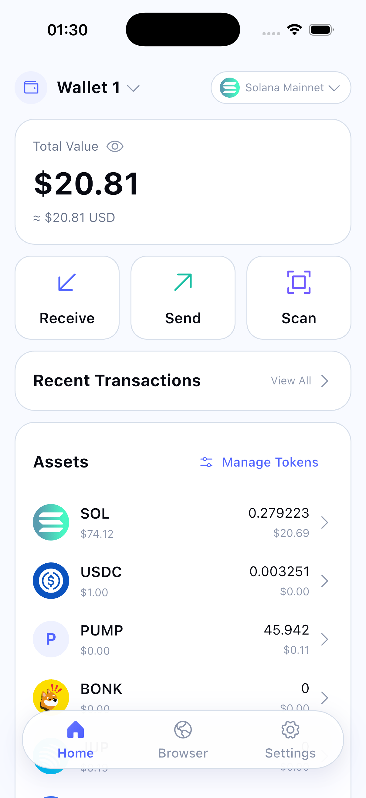
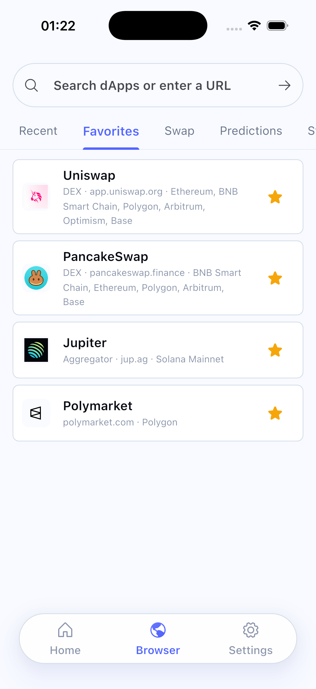
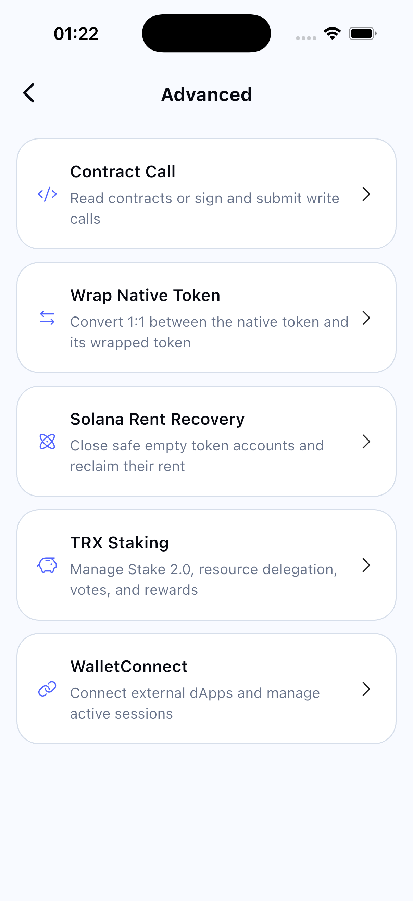
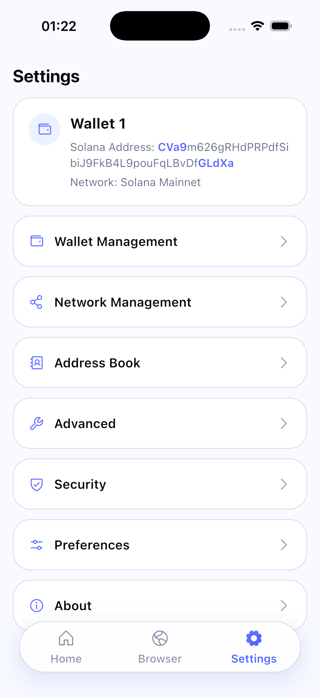

<p align="center">
  
</p>

<h1 align="center">Safe Wallet</h1>

<p align="center">
  使用 Flutter 构建、注重安全的自托管多链钱包。
</p>

<p align="center">
  <a href="README.md">English</a> | 简体中文
</p>

> [!IMPORTANT]
> 为降低软件供应链风险，建议尽可能先审查源代码，再自行编译 Safe Wallet。请只安装由自己构建，或来自可信源码和可信构建流程的 APK。

## 项目简介

Safe Wallet 是一款 Flutter 钱包，用于管理由用户本地控制的 EVM、Bitcoin、TRON、Solana 和 Sui 账户及资产。项目包含钱包创建与导入、资产总览、转账、地址簿、交易历史、二维码扫描、dApp 浏览器和 WalletConnect 集成。

私钥和助记词仅在设备本地加密保存。Safe Wallet 不提供托管后端，无法找回丢失的凭据，也无法撤销链上交易。

## 界面预览

| 资产总览 | dApp 浏览器 | 高级工具 | 设置 |
| --- | --- | --- | --- |
|  |  |  |  |

## 主要功能

- 创建和导入自托管钱包
- 在支持的链上查看资产、收款和发送交易
- 管理自定义 Token、网络和 RPC 节点
- 通过 EVM、Solana 和 Sui 钱包 Provider 浏览 dApp
- 通过 Reown WalletKit（WalletConnect）连接 EVM 和 Solana dApp
- 调用 EVM 合约，以及包装或解包原生 Token
- 回收符合条件的 Solana Token 账户租金
- 在 TRON 上质押 TRX
- 使用地址簿、二维码扫描和本地交易历史
- 在英文和简体中文界面之间切换

## 支持的网络

Safe Wallet 默认内置以下网络。用户还可以添加兼容的自定义 EVM 网络和 RPC 节点。

| 生态 | 默认网络 | 核心钱包操作 | 内置 dApp Provider | WalletConnect |
| --- | --- | :---: | :---: | :---: |
| EVM | Ethereum、BNB Smart Chain、Polygon、Arbitrum、Optimism、Base、HyperEVM | 支持 | 支持 | 支持 |
| Bitcoin | Mainnet | 支持 | 不支持 | 不支持 |
| TRON | Mainnet | 支持 | 不支持 | 不支持 |
| Solana | Mainnet、Devnet | 支持 | 支持 | 支持 |
| Sui | Mainnet、Testnet、Devnet | 支持 | 支持（Wallet Standard） | 不支持 |

“核心钱包操作”包括账户管理、资产展示、收款和转账。具体功能可能因区块链和 RPC 服务商而异。

## 安全模型

Safe Wallet 围绕本地密钥托管和短时授权进行设计：

- 钱包敏感数据使用 AES-256-GCM 加密。
- 密码派生密钥使用 PBKDF2-HMAC-SHA256，迭代 600,000 次。
- 钱包密码不会持久化保存。
- 内存中的数据加密密钥会话在 15 分钟后立即过期。
- 生物识别解锁依赖操作系统安全存储。
- 高风险操作需要重新输入密码认证。
- 敏感剪贴板内容会在短时间后自动清除。
- Android 使用 `FLAG_SECURE` 并禁用备份；iOS 使用录屏遮罩和 no-backup 保护。
- 正式环境 RPC 必须使用 HTTPS；明文 HTTP 仅允许用于本机 loopback 开发节点。

这些措施可以降低风险，但不能保证绝对安全。设备被入侵、恶意依赖、不安全的 RPC 服务、钓鱼攻击和实现缺陷仍然是潜在威胁。

## 平台状态

Android 和 iOS 是仅有的正式支持目标。项目有意不包含或验证 macOS、Windows、Linux 和 Web runner。

## 开始开发

### 环境要求

- Flutter `>=3.41.0`
- Dart `>=3.11.0 <4.0.0`
- Flutter 目标设备所需的平台工具链

当前开发基线为 Flutter `3.41.7` 和 Dart `3.11.5`。

### 本地运行

```bash
flutter pub get
flutter run
```

### 编译 Android APK

从已审查的源代码编译 Release APK：

```bash
flutter pub get
flutter build apk --release
```

如需在构建时配置 WalletConnect 的 Reown Project ID：

```bash
flutter build apk --release \
  --dart-define=REOWN_PROJECT_ID=your_project_id
```

构建产物位于 `build/app/outputs/flutter-apk/`。如果 APK 用于分发，请参考 Flutter 的 [Android 签名文档](https://docs.flutter.dev/deployment/android#sign-the-app)，在 `android/key.properties` 中配置自己的 Release Keystore。请勿提交 Keystore、签名密码或 `key.properties`。

修改本地化源文件后，使用以下命令重新生成翻译：

```bash
dart run slang
```

## WalletConnect 配置

Safe Wallet 使用 Reown WalletKit。可以在构建时传入 Reown Project ID：

```bash
flutter run --dart-define=REOWN_PROJECT_ID=your_project_id
```

未传入该值时应用仍可启动，也可以稍后在设置中填写 Project ID。WalletConnect 会话目前仅支持 EVM 和 Solana namespace；Bitcoin、TRON 和 Sui proposal 会被拒绝。

实现和许可详情见 [WalletConnect 集成文档](docs/walletconnect.md)。

## 验证

提交改动前，请运行与改动相关的检查：

```bash
dart format --output=none --set-exit-if-changed lib test integration_test
flutter analyze
flutter test
```

行为变更和 bug 修复应尽可能包含针对性的回归测试。

## 架构

代码采用 feature-first 结构，并按实际需要划分 domain、data、application 和 presentation 层。项目使用 Riverpod 管理状态和依赖注入。

```text
lib/
├── app/                # 启动、路由、生命周期和应用外壳
├── features/           # 功能模块和链集成
└── shared/             # 通用安全、网络、存储和 UI 代码
test/                   # 单元测试和 Widget 测试
integration_test/       # 端到端和集成测试
docs/                   # 工程、需求和许可证文档
```

更多背景见 [ARCHITECTURE.md](ARCHITECTURE.md) 和 [DESIGN.md](DESIGN.md)。

## 参与贡献

欢迎参与项目贡献。

1. Fork 仓库并创建范围明确的分支。
2. 为行为变更添加或更新测试。
3. 运行格式化、静态分析和相关测试。
4. 创建 Pull Request，说明问题、实现方案和已经完成的验证。

请勿提交私钥、助记词、真实 RPC 凭据或持有资金的测试账户。仓库协作规范见 [AGENTS.md](AGENTS.md)。

## 报告安全问题

请**不要**在公开 Issue 中披露疑似安全漏洞。请使用 GitHub Private Vulnerability Reporting，或为本仓库创建私有 Security Advisory。报告中应包含受影响版本、复现步骤、影响和建议的缓解方式，但不得暴露真实密钥或资金。

## 项目文档

- [架构说明](ARCHITECTURE.md)
- [设计说明](DESIGN.md)
- [WalletConnect 集成](docs/walletconnect.md)
- [功能与测试清单](docs/project-feature-test-cases.md)
- [Solana 租金回收](docs/solana-rent-recovery.md)

## 许可证与第三方声明

Safe Wallet 的自有源代码采用 [MIT 许可证](LICENSE)开源发布。

Safe Wallet 包含按 WalletConnect Community License 分发的 Reown WalletKit 组件。部分内容 © 2025 Reown, Inc. All Rights Reserved. 分发应用前，请阅读 [NOTICE](NOTICE)、[WalletConnect Community License](docs/licenses/reown-walletkit-community-license.txt) 及其中的商业使用门槛。该许可证独立适用于 Reown 组件，不会被项目的 MIT 许可证替代。

## 免责声明

本软件按“原样”提供，不附带任何形式的保证。加密货币交易不可逆，自托管意味着用户需要自行负责密钥、备份、交易确认和软件来源验证。使用风险由用户自行承担。
